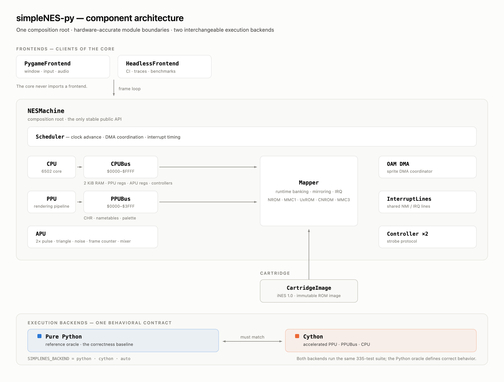
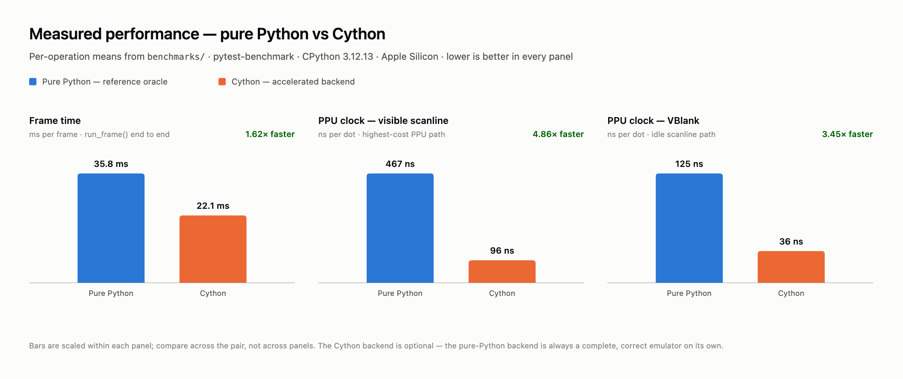

<div align="center">

<h1>simpleNES-py</h1>

<p><b>A NES emulator written from scratch in Python — no emulation libraries, no shortcuts.</b></p>

<p>
  
  
  
  
  
</p>

</div>

* **Written from scratch.** No third-party emulation code, no ported C. About 5,500 lines of readable CPU, PPU, APU, and mapper logic.
* **Correctness before speed.** The pure-Python implementation *is* the specification. The optional Cython backend is only ever allowed to match it, never to redefine it.
* **A real 6502.** The full official instruction set with correct cycle counts, including branch and page-crossing penalties, verified instruction-by-instruction against the standard `nestest` ROM.
* **Five mappers.** NROM, MMC1, UxROM, CNROM, and MMC3 — PRG/CHR banking, mirroring control, and MMC3 scanline IRQ.
* **335 tests, two backends.** The same suite runs against the Python oracle and the Cython build, so the accelerated path can never silently drift.
* **Headless first.** CI, traces, frame hashes, and benchmarks all run without a window. The core never imports a frontend.

> [!NOTE]
> **Scope today.** NTSC only, iNES 1.0 only, and the APU has no DMC channel. Save states, rewinding, a debugger, and NES 2.0 are designed for but not built. See [Compatibility](#-compatibility) for the precise list.

---

# 📌 Introduction

Emulator projects usually make one of two bets. They either chase cycle-perfect accuracy in a systems language and become unreadable, or they stay readable and quietly stop being correct.

simpleNES-py bets that you can have the readable one **and** trust it, by making correctness a property of the architecture rather than a property of how careful the author was feeling.

The trick is that the plain Python implementation is treated as an *oracle*. It is the slow, obvious, easy-to-audit version of every hot module. When a faster backend is introduced, it does not replace the oracle — it sits beside it, and a suite of equivalence tests asserts that both produce identical results. Speed becomes an optimization you can revoke at any time, not a decision you have to live with.

Everything else follows from taking the hardware boundaries seriously.

#### 🎉 What's inside

| | |
|---|---|
| **CPU** | Full official 6502 instruction set · cycle counting · NMI / IRQ / BRK / RESET · JMP indirect page-wrap bug · zero-page wrap · 2A03 decimal-mode behaviour |
| **PPU** | Register interface · `v`/`t` VRAM address registers · write toggle · read buffer · background pipeline · sprite rendering · OAM · VBlank NMI · palette mirrors · nametable mirroring |
| **APU** | 2× pulse · triangle · noise · envelope · length counter · frame counter · linear mixer at 44.1 kHz |
| **Bus** | CPU and PPU address spaces modelled separately, with correct RAM and register mirroring |
| **Cartridge** | iNES 1.0 parser · immutable `CartridgeImage` · runtime `Mapper` |
| **Mappers** | NROM (0) · MMC1 (1) · UxROM (2) · CNROM (3) · MMC3 (4) |
| **Input** | Two controller ports with the standard strobe / shift-register protocol |
| **DMA** | OAM DMA coordinated by the scheduler |
| **Frontends** | Pygame (window, keyboard, audio) · Headless (CI, tests, benchmarks) |
| **Backends** | Pure Python (always available) · Cython-accelerated PPU, PPUBus, and CPU (optional) |

#### 🧭 Design principles

Five rules explain most of the code you will read.

1. **`NESMachine` is the only composition root.** Every component is created and wired in one place. Frontends talk to the emulator through a small stable API and never reach into `CPU` or `PPU` internals.
2. **The CPU bus and the PPU bus are separate objects.** The two address spaces genuinely behave differently; collapsing them into one generic device-list bus is where emulator bugs breed.
3. **`CartridgeImage` and `Mapper` are different things.** The image is the immutable result of parsing a ROM. The mapper is a stateful runtime machine that owns banking, mirroring, and IRQ behaviour.
4. **Interrupts flow through shared lines, not callbacks.** PPU, APU, and mapper raise a line; the CPU samples it at the correct boundary. No component knows another component's address.
5. **The core never imports a frontend.** `import pygame` exists in exactly one file, and it is not in the core.

<details>
<summary><b>Why an oracle instead of just writing it fast the first time</b></summary>

<br>

Optimizing an emulator before it is correct is how you get a program that renders a title screen beautifully and fails three frames later in a way nobody can debug.

The order enforced here is: get the pure-Python path correct against test ROMs, profile it, then accelerate only what profiling proved hot. Because the Python version stays in the tree and stays tested, the Cython version has something to be checked against forever — including after future refactors.

The practical payoff is that `SIMPLENES_BACKEND=python` is always a complete emulator. If a Cython build breaks, is missing, or is suspected of a rendering bug, one environment variable takes you back to the reference implementation.

</details>

---

# 📌 Quick Start

### 0' Requirements

<details>
<summary>Hardware and toolchain</summary>

<br>

| | |
|---|---|
| **Python** | 3.12 or newer |
| **Package manager** | [`uv`](https://docs.astral.sh/uv/) — the commands below assume it |
| **OS** | Anywhere CPython runs. Developed and benchmarked on Apple Silicon |
| **Optional** | `pygame >= 2` for the graphical frontend |
| **Optional** | `cython >= 3.0` + `setuptools >= 64` for the accelerated backend |

No GPU, no build toolchain, and no third-party runtime dependencies are needed for the core emulator.

</details>

### 1' Clone and install

```bash
git clone git@github.com:insomniacdoll/simpleNES-py.git
cd simpleNES-py
uv sync
```

Add the frontend and the development tools when you want them:

```bash
uv sync --extra frontend --extra dev
```

> [!IMPORTANT]
> This project declares its optional dependencies as **extras**, not dependency groups. `uv sync --group dev` will fail; use `--extra`.

### 2' Build the Cython extensions (optional)

```bash
uv run python scripts/build_cython.py
```

This compiles `PPU`, `PPUBus`, and `CPU` in place. Nothing else changes — the emulator simply gets faster. To force a backend regardless of what is built:

```bash
SIMPLENES_BACKEND=python uv run simplenes run game.nes   # force the reference oracle
SIMPLENES_BACKEND=cython uv run simplenes run game.nes   # require the Cython build
# unset → auto-detect: Cython when available, pure Python otherwise
```

### 3' Run a game

```bash
uv run --extra frontend simplenes run path/to/game.nes
```

| Flag | Default | Meaning |
|---|---|---|
| `--scale N` | `2` | Window scale factor (1–4) |
| `--fps N` | `60` | Target frame rate |
| `--title STR` | `simpleNES` | Window title |

Keyboard: arrow keys to move, <kbd>Z</kbd> for A, <kbd>X</kbd> for B, <kbd>Enter</kbd> for Start, right <kbd>Shift</kbd> for Select. <kbd>F12</kbd> writes a PNG screenshot next to the working directory; close the window (or <kbd>Ctrl</kbd>+<kbd>C</kbd> in the terminal) to quit.

> [!NOTE]
> `simplenes run <rom>` requires the `run` subcommand. Launching the graphical frontend needs the `frontend` extra; without it the CLI exits with an install hint rather than an import traceback.

### 4' Run headless

The headless frontend is a Python API, not a CLI flag. It is the intended entry point for CI, regression hashes, and scripted runs:

```python
from simplenes.cartridge.ines import RomParser
from simplenes.frontend.headless import HeadlessFrontend
from simplenes.machine import NESMachine

image = RomParser.parse(open("game.nes", "rb").read())
machine = NESMachine(image)
frontend = HeadlessFrontend()

for _ in range(60):
    machine.run_frame()

frame = machine.framebuffer()   # memoryview of 256 × 240 palette indices
```

`NESMachine` exposes the whole public surface: `reset()`, `run_frame()`, `step_instruction()`, `set_controller_state(port, state)`, `framebuffer()`, `read_audio_samples()`, and `audio_sample_rate()`.

### 5' Run the tests

```bash
uv run --extra dev pytest tests/ -q

SIMPLENES_BACKEND=python uv run --extra dev pytest tests/ -q
SIMPLENES_BACKEND=cython uv run --extra dev pytest tests/ -q   # after build_cython.py
```

### 6' Run the benchmarks

```bash
SIMPLENES_BACKEND=python uv run --extra dev pytest benchmarks/ --benchmark-only -q
SIMPLENES_BACKEND=cython uv run --extra dev pytest benchmarks/ --benchmark-only -q
```

---

# 📌 Architecture



The emulator is a direct transcription of NES hardware boundaries. Each component owns its own state and talks to its neighbours through a narrow, named interface.

```text
Frontend  (window / input / audio  —  never imported by the core)
  └── NESMachine                      composition root, the only public API
        ├── Scheduler              →  drives CPU / PPU / APU clocks, DMA, interrupt timing
        ├── CPU  ── CPUBus         →  2 KiB RAM, PPU regs, APU regs, controllers, mapper
        ├── PPU  ── PPUBus         →  CHR, nametables, palette, mapper
        ├── APU                    →  audio channels, frame counter, mixer
        ├── OAM DMA                →  sprite DMA coordinator
        ├── InterruptLines         →  shared NMI / IRQ lines
        └── Mapper                 →  PRG/CHR banking, mirroring, IRQ
```

### Key boundaries

| Component | Responsibility |
|-----------|---------------|
| `CartridgeImage` | Static ROM metadata — the immutable result of parsing iNES |
| `Mapper` | Runtime banking, mirroring, and IRQ behaviour, per mapper |
| `CPUBus` | CPU address space and register routing |
| `PPUBus` | PPU address space, nametable mirroring, palette mirrors |
| `CPU` | Registers, flags, instruction execution, interrupt sampling |
| `PPU` | Registers, rendering pipeline, OAM, framebuffer, NMI generation |
| `APU` | Audio channels, frame counter, IRQ, sample buffer |
| `Scheduler` | Clock advance, DMA coordination, interrupt timing |
| `NESMachine` | Composition root and stable public API |
| `Frontend` | Window, input, audio output, frame pacing — never imported by core |

### Execution backends

The hot path can run as pure Python or as compiled Cython. The Python implementation is retained permanently as the reference oracle.

| `SIMPLENES_BACKEND` | PPU | PPUBus | CPU | Behaviour |
|---------------------|-----|--------|-----|-----------|
| *(unset)* | auto | auto | auto | Use Cython where built, pure Python elsewhere |
| `python` | pure | pure | pure | Force the reference oracle — the CI and validation path |
| `cython` | Cython | Cython | Cython | Require the compiled build; fails loudly if missing |

---

# 📌 Compatibility

### Mapper support

| ID | Name | PRG banking | CHR banking | Mirroring | IRQ |
|----|------|-------------|-------------|-----------|-----|
| 0 | NROM | 16 / 32 KiB fixed | 8 KiB fixed CHR-ROM or CHR-RAM | Header | — |
| 1 | MMC1 | 32 KiB / 16 + 16 KiB | 8 KiB / 4 + 4 KiB | MMC1 register | — |
| 2 | UxROM | 16 KiB switchable + 16 KiB fixed | 8 KiB CHR-RAM | Header | — |
| 3 | CNROM | 16 / 32 KiB fixed | 8 KiB switchable CHR-ROM | Header | — |
| 4 | MMC3 | 8 KiB × 4 | 2 KiB × 2 + 1 KiB × 4 | MMC3 register | Scanline |

### Emulation status

| Subsystem | Status |
|---|---|
| CPU | Official 6502 instruction set · cycle counting · NMI / IRQ / BRK / RESET |
| PPU | Background, sprites, sprite-zero hit, scrolling, VBlank NMI |
| APU | Pulse ×2, triangle, noise, frame counter, mixer at 44.1 kHz |
| DMC | **Not implemented** |
| Controllers | Two ports; the pygame frontend drives port 1 |
| Save RAM | **Not implemented** |
| Save states | **Not implemented** |

### Known limitations

* **NTSC only.** PAL and Dendy timing are not supported; `NESMachine` rejects a non-NTSC region at construction.
* **iNES 1.0 only.** NES 2.0 headers are not parsed.
* **Four-screen mirroring is rejected** with a clear error rather than emulated incorrectly.
* **No unofficial opcodes.** The illegal 6502 opcode space is deliberately out of scope.
* **Mapper 5 raises `UnsupportedMapperError`** rather than silently misbehaving.
* **No save states, rewinding, debugger, or rewind buffer** — see the roadmap below.

---

# 📌 Performance



Measured with `pytest-benchmark` on CPython 3.12.13 / Apple Silicon. Per-operation means; lower is better.

| Measurement | Pure Python | Cython | Speed-up |
|---|---:|---:|---:|
| `run_frame()` end to end | 35.8 ms | 22.1 ms | **1.62×** |
| `PPU.clock()` — visible scanline | 467 ns/dot | 96 ns/dot | **4.86×** |
| `PPU.clock()` — VBlank | 125 ns/dot | 36 ns/dot | **3.45×** |
| Full test suite (335 tests) | 27.3 s | 7.0 s | **3.9×** |

Two things are worth being honest about:

* **The pure-Python backend is not real-time.** At ~28 FPS it renders roughly half of the NTSC 60 Hz frame budget. It is a correctness oracle and a debugging tool, not a way to play games.
* **The Cython backend is close, but not there.** ~45 FPS is a large improvement and still short of 60. The remaining cost is the CPU and APU, which are still interpreted; accelerating them is the obvious next step, as is moving more of the PPU hot path out of Python-level attribute access.

> [!NOTE]
> These are micro-benchmarks of a synthetic NROM program, not a game-compatibility survey. They measure the emulator's own overhead, which is what changes when you swap backends.

---

# 📌 Testing

Correctness infrastructure is treated as part of the emulator, not as an afterthought. The suite runs **321 unit tests and 14 integration tests** — 335 in total — and passes identically against both backends.

| Layer | What it covers |
|---|---|
| **CPU** | Addressing modes, flags, ADC/SBC, branch and page-crossing cycles, stack, interrupts, wraparound |
| **Bus** | RAM mirrors, PPU register mirrors, controller protocol, mapper ranges, DMA requests |
| **PPU** | Register side effects, write toggle, data buffer, palette mirrors, nametable mirroring, NMI |
| **APU** | Channels, envelope, length counter, frame counter, mixer |
| **Mappers** | NROM 16/32 KiB, CHR-ROM vs CHR-RAM, and banking for MMC1, UxROM, CNROM, MMC3 |
| **Backend equivalence** | Cython `PPU`, `PPUBus`, and `CPU` produce results identical to the Python oracle |
| **`nestest`** | The standard 6502 diagnostic ROM, compared instruction-by-instruction |

```text
tests/
├── unit/                        # 321 tests — one file per component
│   ├── test_cpu.py              # instruction set
│   ├── test_cpu_interrupts.py
│   ├── test_cpu_bus.py
│   ├── test_ppu_registers.py
│   ├── test_ppu_background.py
│   ├── test_ppu_sprites.py
│   ├── test_ppu_bus.py          # PPUBus oracle correctness
│   ├── test_ppu_cy_smoke.py     # Cython PPU  ↔ oracle equivalence
│   ├── test_ppu_bus_cy_smoke.py # Cython PPUBus ↔ oracle equivalence
│   ├── test_cpu_cy_smoke.py     # Cython CPU  ↔ oracle equivalence
│   ├── test_apu.py
│   ├── test_mapper.py  test_mapper2.py  test_mapper3.py
│   ├── test_mmc1.py    test_mmc3.py
│   ├── test_oam_dma.py
│   └── test_pygame_frontend.py
├── integration/                 # 14 tests — whole-machine behaviour
│   ├── test_machine.py          # construction, lifecycle, error paths
│   └── test_nestest.py          # official CPU diagnostic ROM
└── fixtures/
    ├── nrom_sample.py           # programmatic test ROM builder
    └── nestest_helper.py        # nestest log parser
```

The `*_cy_smoke.py` files are the load-bearing ones for the dual-backend design: they are what makes "the Cython build is an optimization, not a fork" a checkable claim instead of a hope.

---

# 📌 Project Structure

```text
src/simplenes/
├── apu/                     # Audio Processing Unit
│   ├── apu.py               #   coordinator
│   ├── pulse.py             #   pulse channel (2 instances)
│   ├── triangle.py          #   triangle channel
│   ├── noise.py             #   noise channel
│   ├── envelope.py          #   envelope generator
│   ├── length_counter.py
│   ├── frame_counter.py     #   $4017 frame counter
│   └── mixer.py             #   DAC → linear output mixer
├── bus/
│   ├── __init__.py          #   PPUBus backend auto-selection
│   ├── cpu_bus.py           #   CPU address space ($0000–$FFFF)
│   ├── ppu_bus.py           #   PPU address space ($0000–$3FFF) — pure Python oracle
│   └── _ppu_bus_cy.pyx      #   Cython PPUBus (optional)
├── cartridge/
│   ├── image.py             #   CartridgeImage + Mirroring enum
│   ├── ines.py              #   iNES 1.0 parser
│   ├── mapper.py            #   Mapper protocol
│   └── mappers/             #   mapper000_nrom … mapper004_mmc3
├── cpu/
│   ├── cpu.py               #   6502 core — pure Python oracle
│   ├── opcodes.py           #   opcode table
│   └── _cpu_cy.pyx          #   Cython CPU (optional)
├── dma/
│   └── oam_dma.py           #   OAM DMA controller
├── frontend/
│   ├── protocol.py          #   Frontend interface
│   ├── headless.py          #   headless frontend
│   ├── palette.py           #   NES palette LUT
│   └── pygame_frontend.py   #   the only file that imports pygame
├── input/
│   └── controller.py        #   standard controller
├── ppu/
│   ├── __init__.py          #   PPU backend auto-selection
│   ├── ppu.py               #   PPU core — pure Python oracle
│   └── _ppu_cy.pyx          #   Cython PPU (optional)
├── machine.py               # NESMachine composition root
├── scheduler.py             # clock scheduler
├── interrupts.py            # InterruptLines
├── timing.py                # NTSC timing constants
├── errors.py                # domain errors
├── cli.py                   # CLI entry point
└── __main__.py              # enables `python -m simplenes`

benchmarks/                  # performance micro-benchmarks
scripts/build_cython.py      # in-place Cython extension builder
docs/images/                 # figures used by this README
```

---

# 📌 Roadmap

Phases follow [`docs/architecture.md`](docs/architecture.md), which remains the architectural source of truth.

| Phase | Scope | Status |
|---|---|---|
| 0 | Project skeleton, packaging, errors, timing | ✅ |
| 1 | iNES parsing, `CartridgeImage`, NROM, CPU/PPU bus mapping | ✅ |
| 2 | CPU: official opcodes, addressing modes, interrupts, cycles, trace | ✅ |
| 3 | PPU registers, mirroring, VBlank NMI | ✅ |
| 4 | Background rendering, scrolling, palette, framebuffer | ✅ |
| 5 | Sprites, OAM, sprite-zero hit, controller, OAM DMA | ✅ |
| 6 | Pygame frontend: window, input, scaling, frame pacing | ✅ |
| 7 | APU: pulse, triangle, noise, frame counter, mixer | ✅ |
| 8 | Additional mappers: UxROM → CNROM → MMC1 → MMC3 | ✅ |
| 9 | Performance: profiling, benchmarks, native hot paths | 🚧 PPU, PPUBus, and CPU accelerated; CPU/APU work remains |
| 10 | NES 2.0, save states, debugger, rewind, PAL/Dendy, ZIP ROM | ⬜ |

Near-term priorities, in order: **DMC channel** → **CPU/APU acceleration to reach 60 FPS** → **save states** → **NES 2.0**.

---

# 📌 Requirements

* Python **3.12+**
* Core emulator: **zero runtime dependencies**
* Optional — graphical frontend: `pygame >= 2` (`uv sync --extra frontend`)
* Optional — accelerated backend: `cython >= 3.0`, `setuptools >= 64` (`uv sync --extra cython` or `--extra dev`)
* Optional — benchmarks: `pytest-benchmark >= 5.2.3` (included in `--extra dev`)
* Region support: **NTSC only**

---

# 🙏 Acknowledgements

* The **`nestest`** ROM by kevtris, the standard CPU diagnostic that gates the 6502 implementation.
* The **NESdev wiki**, whose hardware documentation made every module in this repository possible.
* **blargg's** test ROMs, whose methodology shaped the trace-and-regression approach used here.
* The authors of the many open-source NES emulators whose published behaviour was used to cross-check edge cases.

---

# ⚖️ License

MIT
